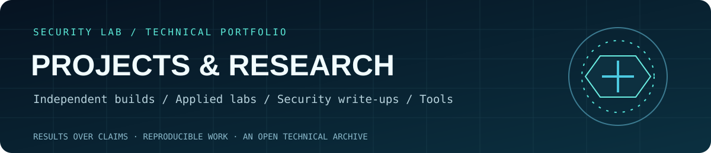
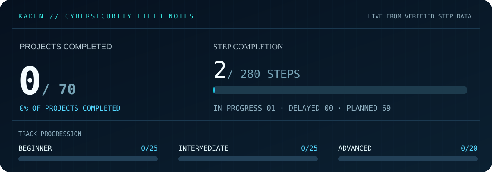

**Cybersecurity projects, experiments, tools and research.**

## About this repository

This is where I keep my cybersecurity projects, from small lab experiments to scripts, research and more involved builds. I'll be adding work here as I learn new tools and find new things I want to explore.

## Project areas

| Area | Contents |
|:--|:--|
| [Selected work](PORTFOLIO.md) | Completed projects and their results |
| [Independent projects](independent-projects/) | Projects outside my structured learning plan |
| [Tools](tools/) | Scripts, utilities and automation |
| [Research](research/) | Security topics, investigations and reading |
| [Case studies](case-studies/) | Lab reports and security write-ups |
| [70-project roadmap](docs/roadmap.md) | My structured cybersecurity learning project list |

## On my desk

**[B06 — Home cybersecurity lab](projects/beginner/B06/README.md)**

Starting with an isolated virtual-machine lab. The plan covers setup, Linux networking, a second test system and snapshots. I'll add the diagram, configuration notes and test results as I work through it.

## 70-project roadmap

Alongside independent work, I'm using a list of 70 projects to explore cybersecurity through Year 12 and Year 13. They range from Linux and networking to detection, security tools and research.

| Level | Projects | Folder |
|:--|:--|:--|
| Beginner | B01–B25 | [Browse](projects/beginner/) |
| Intermediate | I26–I50 | [Browse](projects/intermediate/) |
| Advanced | A51–A70 | [Browse](projects/advanced/) |

The progress chart tracks this project list, not every project I've worked on. Individual steps and dates are kept in [the progress file](data/progress.json).

## Elsewhere

[Learning log](https://github.com/kadencybsec/cyber-learning-log) · [Profile](https://github.com/kadencybsec) · [Project index](PORTFOLIO.md)
