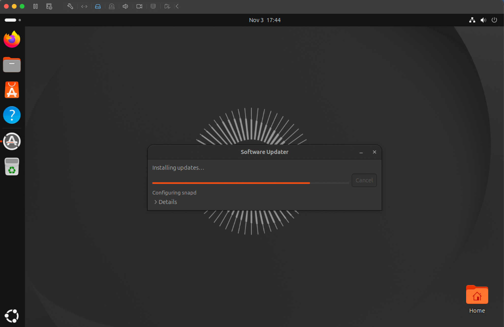
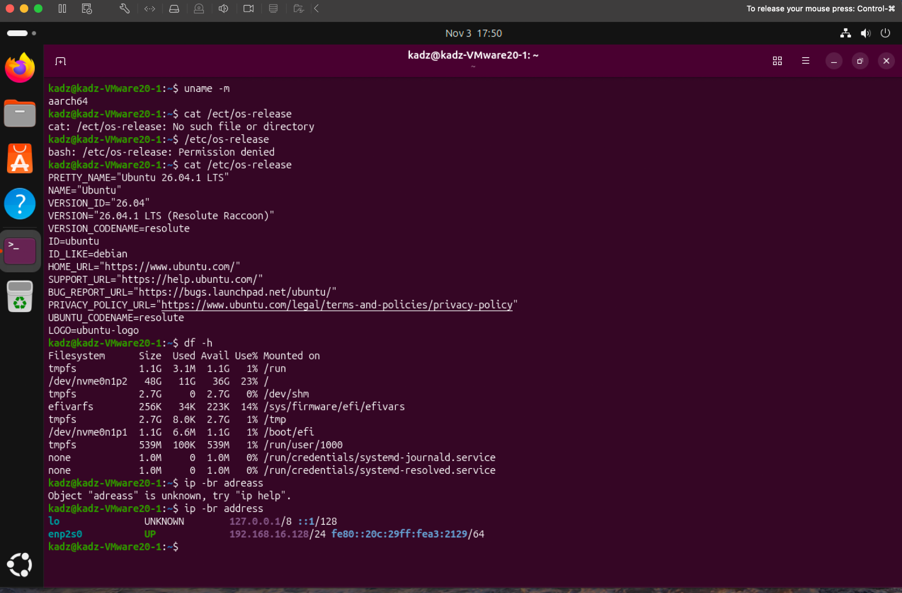

# Ubuntu installation verification

**Project:** B06 — Home cybersecurity lab  
**Step:** B06-S2  
**Date:** 3 November 2026  
**Result:** Ubuntu installed, booted and checked in Terminal

## What I did

Installed Ubuntu Desktop 26.04.1 LTS (ARM64) in VMware Fusion on an Apple Silicon Mac. I used a virtual disk configured for 50 GB, 6 GB of RAM and 2 CPU cores. After the installation completed, Ubuntu restarted into its desktop and I opened Terminal to check the system.

## Checks and results

| Command | Result observed | Why I ran it |
|:--|:--|:--|
| `uname -m` | `aarch64` | Confirms the running Linux architecture is ARM64 |
| `cat /etc/os-release` | `Ubuntu 26.04.1 LTS`, codename `resolute` | Identifies the OS and release |
| `df -h` | Root filesystem `/dev/nvme0n1p2`: **48G total, 11G used, 36G available** | Checks storage after installation |
| `ip -br address` | `enp2s0` is **UP**, with a private IPv4 address | Checks whether the guest has a working network interface |

The VM's specific IPv4/IPv6 addresses are intentionally omitted from this public report. An interface being UP does **not** prove network isolation or internet reachability. The lab's host-only network will be configured and tested in B06-S3.

## Terminal mistakes I corrected

- First entered `cat /ect/os-release`, but the directory is `/etc`, not `/ect`. The file could not be found.
- Tried to run `/etc/os-release` directly. The shell returned **Permission denied** because the file isn't an executable command. `cat` reads its contents.
- Entered `ip -br adress` with one `d`. The `ip` command rejected the unknown argument; `address` is the correct spelling.

## What these commands mean

- `uname` displays information about the running operating system; `-m` selects the machine architecture.
- `cat` prints the contents of a text file.
- `df` reports filesystem space; `-h` prints sizes in human-readable units.
- `ip` shows or changes networking information; `-br` uses brief output and `address` selects IP-address information.

## Evidence and limitations

The original screenshots have now been uploaded to [the B06 screenshot collection](screenshots/README.md). These are the unedited screenshots from the installation and command checks.

**First successful desktop boot and software updates:**

**Terminal checks, including corrected command mistakes:**

The images document the observed state at the time. A screenshot does not on its own verify network isolation or snapshot recovery.

This verifies an installed, bootable ARM64 Ubuntu VM and the introductory commands required for B06-S2. It does not verify the future second VM, host-only isolation or snapshot recovery.

## Next

- **B06-S3:** Add a second harmless ARM64 VM or container, move both VMs to a private host-only network, and verify network behaviour.
- **B06-S4:** Save and test restoration from snapshots; write the final lab inventory and architecture report.

[Return to B06 project](../README.md) · [Earlier lab design](lab-plan.md)
